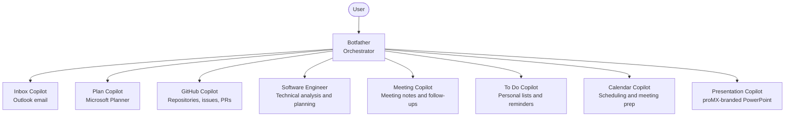

# Copilot Studio Productivity Agents

This repository contains configuration and authoring material for a suite of productivity agents built for the **new Copilot Studio agent experience**. It is not an application or a deployable code package: each agent is configured in Copilot Studio using its system prompt, skills, connectors, and evaluation test set.

The design uses **Botfather** as an optional front door. It routes requests to focused agents and combines their responses. Specialists can also be used independently. The agent descriptions in their READMEs are intended for Copilot Studio and for Botfather's connected-agent routing.

## Agent Map



The arrows represent Botfather's **connected-agent routing**, not direct connections among specialists. For example, meeting action items that should become Planner tasks are handed off through Botfather.

## Agents

| Agent | Folder | Best for | Important boundary |
|---|---|---|---|
| **Botfather** (orchestrator) | [botfather](botfather) | Routing requests, coordinating multi-agent work, combining answers | Has no email or Planner tools of its own; specialists must be configured as connected agents |
| **Inbox Copilot** | [outlook-agent](outlook-agent) | Email triage and search, phishing checks, reply drafts, alerts, daily briefings | Sending, replying, moving messages, and creating events should require confirmation |
| **Plan Copilot** | [planner-agent](planner-agent) | Planner task capture, task briefings, plan status, and project breakdowns | Planner connector support may be limited to basic plans, not premium plans |
| **GitHub Copilot** | [github-agent](github-agent) | Repository discovery, issue and PR tracking, duplicate searches, drafting work items | Not for code edits or code review; connector results may not include a PR diff |
| **Software Engineer** | [software-engineer-agent](software-engineer-agent) | Technical analysis, architecture tradeoffs, and project plans | Read-only planning agent; it does not implement changes |
| **Meeting Copilot** | [meeting-agent](meeting-agent) | Meeting summaries, decisions, action items, and recap drafts | **Transcript actions are currently blocked**; use pasted or uploaded transcripts and notes until access is enabled |
| **To Do Copilot** | [todo-agent](todo-agent) | Personal reminders, lists, and individual task reviews | Use Plan Copilot for shared team plans and tasks assigned to others |
| **Calendar Copilot** | [calendar-agent](calendar-agent) | Calendar overviews, availability, scheduling, focus time, meeting prep | Creating, updating, or deleting events and responding to invitations should require confirmation |
| **Presentation Copilot** | [powerpoint-agent](powerpoint-agent) | Creating slide narratives and branded PowerPoint files | Actual `.pptx` creation requires a configured file-generation action and an approved template; otherwise it returns slide-ready content |

Each agent folder has its own README with its description, recommended connectors and actions, settings, and relevant limitations. See its `skills/` directory for detailed skill instructions.

## Repository Contents

Each specialist folder contains:

- `system-prompt.md`: instructions to paste into the agent's Instructions.
- `skills/<skill-name>/SKILL.md`: capability-specific instructions to add under Build → Skills.
- `test-set.csv`: evaluation cases to import into Copilot Studio's Evaluate experience.
- `README.md`: setup notes, description, tools, settings, and known constraints.

Botfather has routing and daily-command-center skills. The Software Engineer folder also includes `AGENT-PLAN.md`, a Copilot Studio prompt, and reusable templates in `docs/templates/`.

```text
botfather/                 Orchestration and multi-agent handoff
outlook-agent/             Email and inbox workflows
planner-agent/             Shared Planner tasks and plans
github-agent/              GitHub repository and work-item workflows
software-engineer-agent/   Technical analysis and planning
meeting-agent/             Meeting summaries and follow-ups
todo-agent/                Personal To Do lists and reminders
calendar-agent/            Calendar and scheduling workflows
powerpoint-agent/           Presentation content and branded PowerPoint generation
```

## Set Up an Agent

1. Create an agent in the **new Copilot Studio experience**.
2. Copy that folder's `system-prompt.md` into the agent's Instructions.
3. Under **Build → Skills**, add each skill from `skills/<skill-name>/SKILL.md`.
4. Configure the connectors and actions listed in that agent's README. Action labels can vary by connector version, so match the action's function when needed.
5. Configure per-user authentication for personal Microsoft 365 data and apply confirmation requirements to write or destructive actions as specified in the agent README.
6. Import `test-set.csv` under **Evaluate → New evaluation → Single response** and run the evaluation before rollout.
7. Publish the agent and share it with its intended users.

### Connect the Specialists to Botfather

After setting up each specialist, publish it, make it available to connect, and add it in Botfather under **Build → Connected agents**. All connected agents must be in the same environment. Share every specialist separately with each intended user; access to Botfather alone does not grant access to its connected agents. Give each connected agent a clear description so routing has the right signals. See [Botfather's README](botfather/README.md) for the complete connection requirements and procedure for adding specialists.

## Security and Operational Notes

- Use user-authenticated connections for personal mailboxes, calendars, tasks, and other user-scoped data. A connected agent should only access data its user is authorized to access.
- Require user confirmation before sending or modifying data. The agent-specific READMEs identify the actions that should ask before running; preserve those safeguards when configuring connectors.
- Keep connector permissions scoped to the agent's job. In particular, the Software Engineer agent is intended to use read-only technical context, and GitHub Copilot should not receive merge, permissions, webhook, or secret-management actions.
- Transcript retrieval for Meeting Copilot requires both a transcribed meeting and the appropriate Teams/Graph transcript access. Until those prerequisites are met, provide meeting text directly.
- Review each agent's README for connector limitations, authentication requirements, optional triggers, and model guidance. Model availability can vary by environment; evaluate the selected model against the included test set.

## Evaluations

The CSV files are test sets for Copilot Studio's in-product evaluation workflow, not a local test runner. Import each CSV into its corresponding agent's evaluation and review the results after changing instructions, skills, connected tools, or routing descriptions. Botfather's test set focuses on routing; specialist test sets exercise their domain workflows.

## Making Changes

- Keep each agent's responsibilities and routing description aligned. When a specialist is added or renamed, update Botfather's connected-agent setup, its system prompt, and routing evaluation cases.
- Update the relevant `system-prompt.md`, skill, README, and evaluation cases together when behavior or connector assumptions change.
- Treat connector configuration, authentication, publishing, and sharing as Copilot Studio environment setup; those settings are not deployed by this repository.